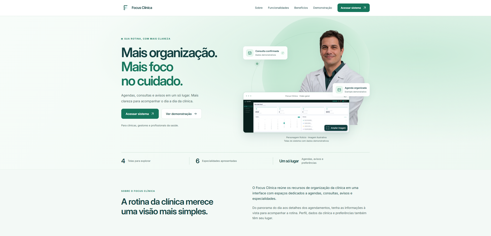

# Focus Clínica — Landing Page

Landing page institucional para apresentar o Focus Clínica a clínicas, gestores e profissionais da saúde. Reúne informações sobre calendário, agendamentos, notificações e especialidades, com capturas reais e acesso à plataforma.



## Links

- [GitHub Pages](https://lcsf-dev.github.io/landing-page-focus-clinica/)
- [Netlify](https://landing-page-focus-clinica-lcsf.netlify.app/)
- [Repositório](https://github.com/Lcsf-dev/landing-page-focus-clinica)
- [Figma](https://www.figma.com/design/P7K5fBiCqhBsehhrR5BNqp/)
- [Sistema de referência](https://focus-clinica.netlify.app/)

## Funcionalidades

- Cabeçalho, hero, sobre, funcionalidades, benefícios, demonstração, chamada para ação e rodapé, com perguntas frequentes antes da chamada final.
- Galeria de visão geral, agendamentos, especialidades e configurações, com capturas reais e dados demonstrativos.
- Menu responsivo, navegação por âncoras, abas por clique/teclado e ampliação das capturas.
- Perfis públicos da equipe no rodapé, com nomes e links estáticos preservados se a API falhar.
- Hero com personagem médico fictício, captura real e exemplos demonstrativos; funcionalidades em composição assimétrica.
- Entradas coordenadas, microinterações e galeria com prévias em recorte e altura estável.
- Layout responsivo, foco visível, estados finais para movimento reduzido e conteúdo disponível sem JavaScript.

## Executar localmente

Pré-requisitos: Node.js 22 atualizado (ou superior) e npm. A aplicação usa HTML, CSS e JavaScript com Vite para desenvolvimento e build, Vitest para testes unitários e de integração e Playwright para testes no navegador.

```powershell
npm ci
npm run dev
```

Abra o endereço informado pelo Vite, normalmente <http://localhost:5173>. Encerre com `Ctrl+C`.

| Comando | Finalidade |
| --- | --- |
| `npm run dev` | Iniciar o servidor de desenvolvimento |
| `npm run build` | Gerar o pacote público em `dist/` |
| `npm run preview` | Conferir o build, normalmente em <http://localhost:4173> |
| `npm test` | Executar testes unitários e de integração com respostas controladas |
| `npm run test:build` | Gerar o build e verificar referências e arquivos públicos |
| `npx playwright install chromium firefox` | Preparar os navegadores para os testes E2E |
| `npm run test:e2e` | Executar a suíte E2E em Chromium e Firefox |

O E2E inicia o preview e gera o build quando não há servidor disponível. Para evitar builds duplicados na conferência local, reutilize um preview já iniciado após `npm run test:build`. No CI, preserve a sequência obrigatória do workflow.

## Estrutura

```text
.
├── .github/       # Workflows e modelos de contribuição
├── css/           # Estilos e fonte Inter local com licença
├── docs/          # Documentação técnica e evidências
├── public/img/    # Capturas originais, recortes, marca e ícones
├── js/
│   ├── api/       # Cliente e validação dos perfis do GitHub
│   ├── team/      # Carregamento e apresentação dos integrantes
│   ├── main.js
│   ├── menu.js
│   ├── demo-tabs.js
│   ├── image-viewer.js
│   └── reveal-animations.js
├── tests/         # Testes unitários, integração, build e E2E
├── utils/         # Utilitários compartilhados
├── index.html
├── vite.config.js
├── playwright.config.js
├── netlify.toml
└── package.json
```

`dist/` é gerado e ignorado pelo Git. Nomes técnicos usam inglês; interface e documentação da equipe usam português. Convenções e decisões estão em [Refatoração](docs/refactoring.md).

## Demonstração e acessibilidade

As quatro capturas completas ficam em `public/img/`, com seus PNGs originais preservados. Em telas pequenas, recortes de 600 × 500 px destacam uma região; a ampliação sempre abre a captura completa. No diálogo, “Ver em tamanho original” permite ler os detalhes com rolagem horizontal e vertical, inclusive por teclado. Escape fecha a imagem e devolve o foco ao elemento de abertura.

As abas aceitam setas, Home e End. Os cartões de funcionalidades abrem o painel correspondente. O hero usa versões WebP transparentes do personagem ilustrativo. As animações de entrada executam uma vez ao aparecer e os cartões têm movimento de duração limitada. Os valores da faixa de apresentação correspondem às quatro telas e seis especialidades visíveis.

A navegação permanece disponível sem JavaScript, com todas as capturas apresentadas em sequência. Nessa situação, a ampliação usa o link direto para o PNG.

## Publicação

O Netlify publica `dist/` a partir de `main`, usando `npm run build`. A integração segue branch da tarefa → PR para `develop` → checks → merge → PR para `main` → checks → merge. A URL canônica e a imagem social apontam para a publicação principal no Netlify. Consulte [CI/CD e publicação](docs/deployment.md).

## Integração com o GitHub

O rodapé consulta `GET https://api.github.com/users/{username}` para atualizar nome público, avatar e link dos quatro integrantes. As consultas começam perto do rodapé, não utilizam token e não envolvem dados clínicos. Falhas mantêm os créditos estáticos; a nova tentativa consulta somente perfis pendentes e bloqueia carregamentos simultâneos.

Veja o [contrato e tratamento de falhas](docs/api.md), o [roteiro do Insomnia](docs/insomnia.md) e a [descrição OpenAPI](docs/api.openapi.json).

## Equipe

| Integrante | Frente |
| --- | --- |
| [Lucas Fernandes](https://github.com/Lcsf-dev) | Desenvolvimento e integração |
| [Thamires](https://github.com/thaamiresffranca) | Revisão visual |
| [Gabriel Enzo](https://github.com/genzo-dev) | API e testes |
| [DumbRyder](https://github.com/DumbRyder) | Interface e responsividade |

As frentes indicam responsabilidades; registros de execução e aprovação são separados. Detalhes em [Equipe](docs/team.md).

## Documentação técnica

- [Requisitos e escopo](docs/requirements.md), [planejamento](docs/planning.md) e [tarefas](docs/tasks.md).
- [Design e diferenças para o Figma](docs/design.md); [origem dos recursos visuais](docs/images.md).
- [Testes e limitações conhecidas](docs/testing.md).
- [Fluxo Git](docs/git-workflow.md), [CI/CD e publicação](docs/deployment.md) e [histórico de alterações](docs/changelog.md).
